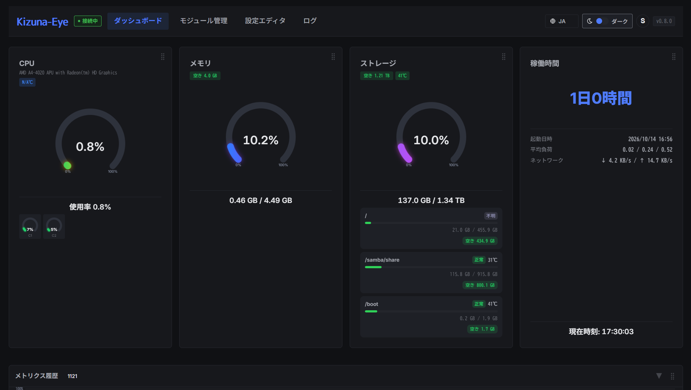
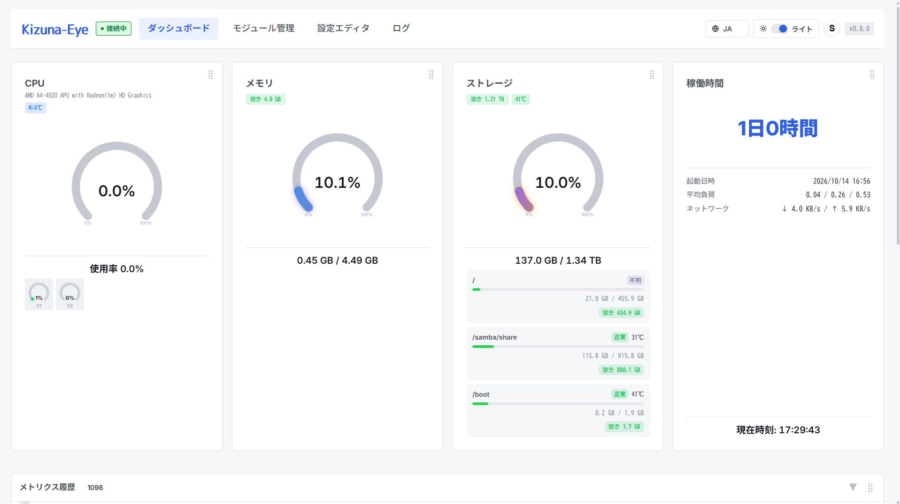
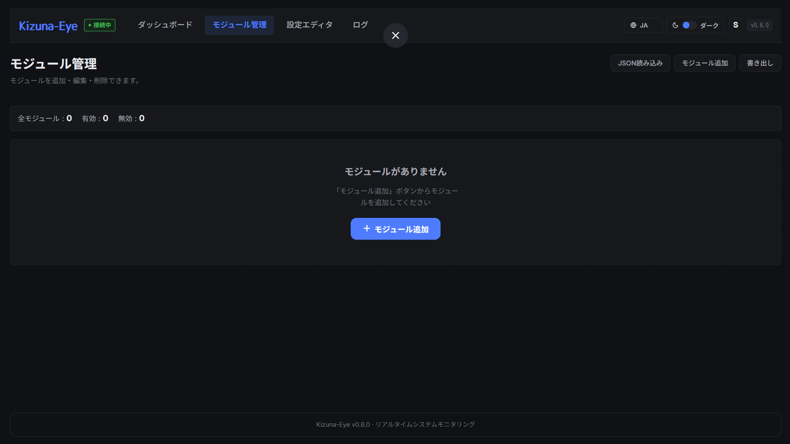
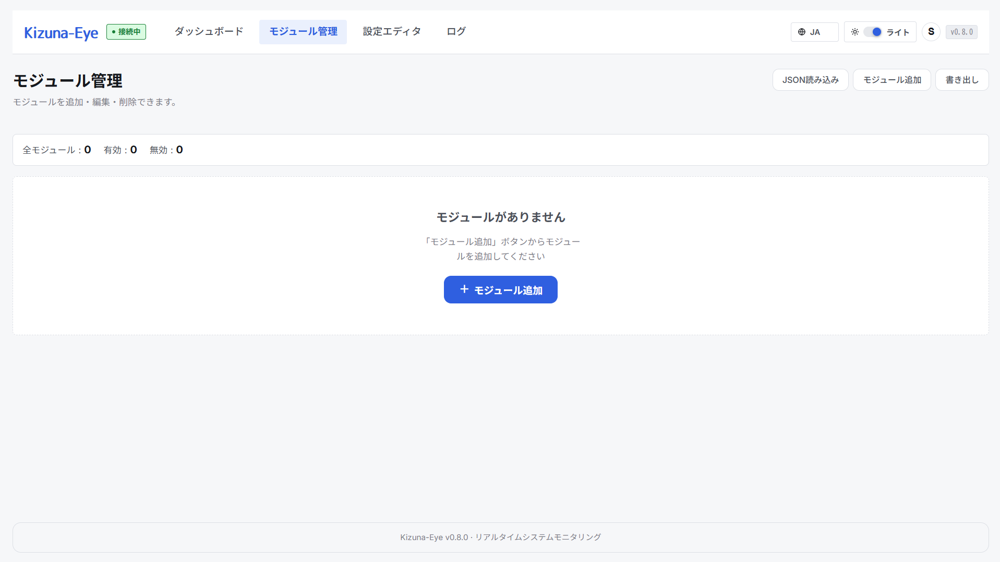
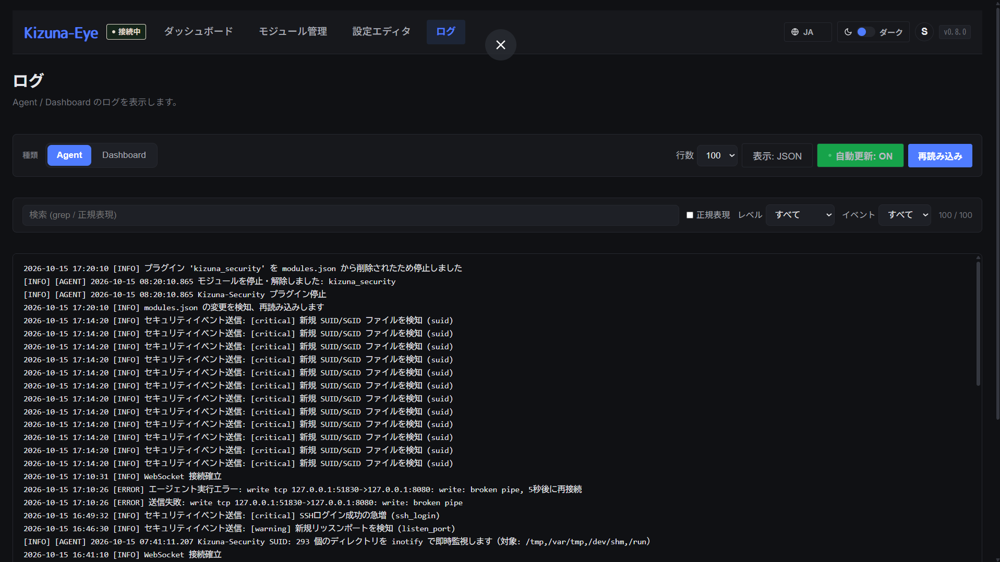
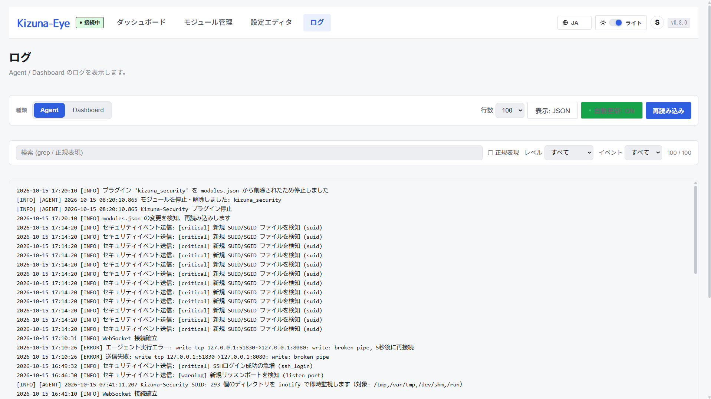
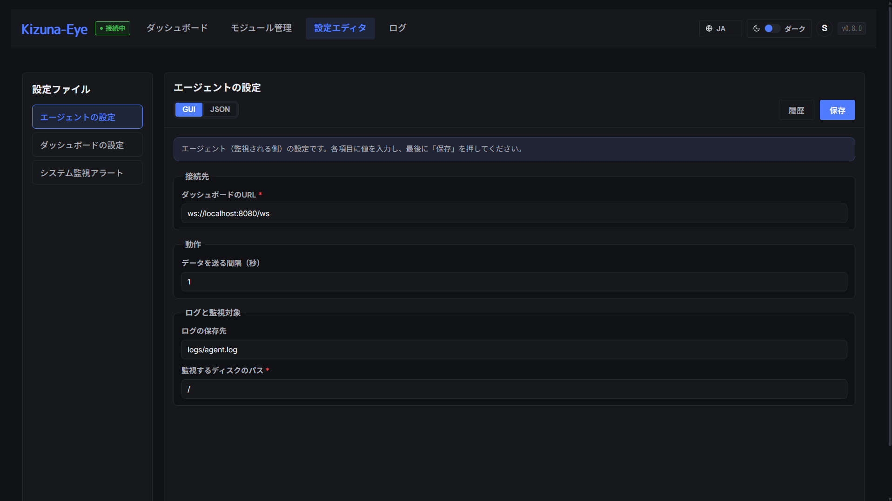
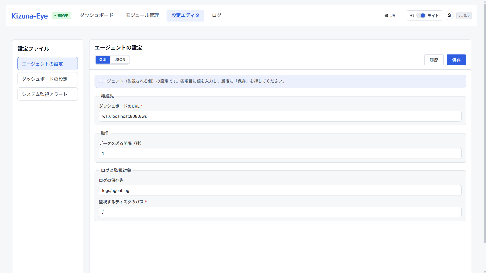
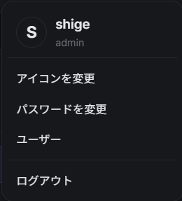
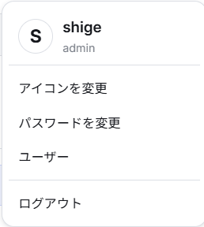

# Kizuna-Eye

Go製の軽量サーバー監視ツール。低スペックマシン向けに設計されています。

[English](README.md) | **日本語**

**Kizuna-Eye** は、低スペックサーバー向けに設計された、Go製の軽量サーバー監視ツールです。ダッシュボードとエージェントの合計メモリ使用量は **約30〜50MB** で、シングルボードコンピュータや小型マシン、古いPCでも快適に動作します。

## 特徴

- **軽量**: ダッシュボード + エージェントで約30〜50MB
- **リアルタイム更新**: WebSocket経由で1秒以内に反映
- **ブラウザベース設定**: SSH不要で全設定が完結
- **認証（インストーラが有効化）**: ロール（admin / operator / viewer）、bcrypt パスワード、セッション Cookie、IP単位のログイン試行制限
- **プラグイン機構**: Goの `.so` ダイナミックプラグインで機能拡張
- **通知**: Discord / Slack / Telegram / LINE / Email（SMTP）。5種すべて実装済み。設定エディタ UI で編集できるのは現在 **Discord のみ**。Slack / Telegram / LINE / Email は `dashboard_config.json` を直接編集して設定する。
- **ダーク / ライトモード**: OS設定にも追従
- **プロセス一覧**: CPU / メモリ順ソート
- **ディスク S.M.A.R.T**: ディスクの健康状態と温度（`smartctl` 使用時、任意）
- **ネットワーク速度**: リアルタイム表示
- **メトリクス履歴**: CPU / メモリ / ディスクの推移グラフ（直近約1時間）
- **アラート履歴の永続化**: 再起動後も履歴が残り、UIから閲覧・クリア可能
- **アラート閾値の動的変更**: UI から再起動なしで変更可能
- **Prometheus メトリクス**: `GET /api/metrics`
- **ログローテーション**: サイズベースで自動ローテーション
- **i18n**: 日本語 / 英語 UI
- **軽量・自己完結**: データベースや外部サービス不要の単一バイナリ。信頼できるネットワーク / VPN 内での利用を想定

## スクリーンショット

  
   
  <em>リアルタイムシステム監視ダッシュボード（ダークモード）</em>

### ダッシュボード

| ダーク | ライト |
| :---: | :---: |
|  |  |

### モジュール管理

| ダーク | ライト |
| :---: | :---: |
|  |  |

### ログ

| ダーク | ライト |
| :---: | :---: |
|  |  |

### 設定エディタ

| ダーク | ライト |
| :---: | :---: |
|  |  |

### ユーザー管理

| ダーク | ライト |
| :---: | :---: |
|  |  |

## アーキテクチャ

Kizuna-Eye は2つの主要コンポーネントで構成されています。

- **Agent**: 監視対象サーバーでシステムメトリクスを収集し、プラグインを実行します。
- **Dashboard**: Agent から WebSocket 経由でメトリクスを受信し、Web UI を提供し、通知を送信します。

Agent と Dashboard は WebSocket で通信します。プラグインは Agent によって `.so` 共有オブジェクトとしてロードされます。プラグインがステータスやセキュリティイベントを報告すると、Agent がそれを集約して Dashboard に転送します。

## 動作要件

- **Go 1.27.2** 以上（パッチまで `go.mod` の `toolchain` で固定。ホストとプラグインは同一バージョンでビルドが必要）
- **Ubuntu Server** 20.04 以上（他のLinuxディストリビューションでも動作可）
- **CGO_ENABLED=1**（`plugin` パッケージ使用時）
- **rsync**（SSHファイル転送使用時）
- **smartctl**（任意、S.M.A.R.T監視使用時）

## セキュリティ上の注意

Kizuna-Eye は信頼できるネットワーク / VPN 内での利用を想定しています。以下の設定は**実質的なリモートコード実行（RCE）**につながるため、特に注意してください。

- **`plugins_upload_enabled: true` と `auth.enabled: false` を同時に使わないでください。** この組み合わせでは、ネットワーク上の誰でも `.so` プラグインをアップロードして実行でき、サーバーを乗っ取られます。プラグインのアップロードを使う場合は必ず認証を有効にしてください（起動時にも警告ログを出力します）。
- **設定ファイルには秘密情報が含まれます。** `dashboard_config.json`（`agent_token` / `webhook_url`）と `agent_config.json`（`token`）はリポジトリにコミットせず、権限を 0600 に保ってください（`.gitignore` 済み）。
- **`/api/config` は秘密情報をマスクして返します。** マスク値（`***`）をそのまま保存しても既存の秘密は保持されますが、`users.json` と同様に取り扱いには注意してください。
- **プラグイン `.so` は信頼できるものだけを配置してください。** Go プラグインはサーバー本体と同じ権限で動作します。
- **自動更新はサプライチェーンリスクです。** `auto_update.enabled` を true にすると、Agent は GitHub Releases を監視し、新しいバージョンを検知すると `safe_update.sh`（git pull + 再ビルド + 再起動）を実行します。GitHub のリポジトリやアカウントが侵害されると、**サーバーが攻撃者のコードを自動でビルド・実行する経路（実質 RCE）**になり得ます。**既定は無効**です。完全に信頼できるリポジトリでのみ有効化するか、`./update.sh` で手動更新してください。有効時は起動時に警告ログを出力します。
- **通知本文は外部入力由来の値を含みます。** 各チャンネルでエスケープとメンション無効化を行っています。

## プラグイン再ビルドの運用注意（重要）

Go の `plugin` パッケージは、プラグインと本体が**共有パッケージのハッシュまで完全一致**していることを要求します。したがって、次のいずれかを変更した場合は、**Agent 本体と全プラグイン（`.so`）を同一ソースから同時に再ビルド**してください。片方だけ再ビルドすると `plugin was built with a different version of package ...` で読み込みに失敗します。

- `pkg/module`（プラグインの共通型・インターフェース。`Module` / `ConfigField` / `SecurityEvent` など）
- `pkg/status`（`SystemStatus` などの共有型）
- `pkg/fsutil`（原子的なファイル書き込みなどの共有ヘルパー。プラグインも使用）

加えて、**モジュール解決の方法**と `-trimpath` も一致させる必要があります。本体を `go.work` で、プラグインを `GOWORK=off`（プラグイン側の `replace Kizuna-Eye => ...`）でビルドすると、同じソースでも共有パッケージの build ID が食い違い、ロードに失敗します。`./build-all.sh`（または `scripts/build-plugin.sh`）は、本体と全プラグインを 1 つの combined `go.work`・`-trimpath` 常時 ON でビルドします。

手で行う場合の手順: (1) 本体と各プラグインのディレクトリを 1 つの `go.work` に入れる。(2) 本体と各プラグインを同一ツールチェーン・`-trimpath` でビルドする（例: `CGO_ENABLED=1 go build -trimpath -buildvcs=false -buildmode=plugin -o kizuna_security.so .`）。(3) 生成した `.so` を plugins ディレクトリへ配備し、agent を再起動。`scripts/build-plugin.sh` はソースを `KIZUNA_SEC_PLUGIN_DIR` / `KIZUNA_LITE_PLUGIN_DIR` で指定するとビルド→署名→配備を1コマンドで行えます。

## インストール

### APT でインストール（推奨・Debian/Ubuntu）

ビルド不要で、依存関係も自動で導入されます。

    # 公開鍵を登録（dearmor が必要）
    curl -fsSL https://exiserverteam.github.io/Kizuna-Eye/kizuna.gpg \
      | sudo gpg --dearmor -o /usr/share/keyrings/kizuna.gpg

    # リポジトリを追加
    echo "deb [signed-by=/usr/share/keyrings/kizuna.gpg] https://exiserverteam.github.io/Kizuna-Eye stable main" \
      | sudo tee /etc/apt/sources.list.d/kizuna.list

    sudo apt update
    sudo apt install kizuna-eye

`apt install kizuna-eye` がセットアップを全部やるため、追加作業は不要です:

- 専用ユーザー `kizuna-eye` とデータディレクトリ `/var/lib/kizuna-eye/data` を作成する。
- `dashboard_config.json` / `agent_config.json` を生成し、ランダムな `agent_token` を入れる（設定は 0600）。
- **認証を有効化**（`auth.enabled: true` / `public_viewer: false`）し、UI 言語を書き込む。
- systemd unit（`kizuna-eye-agent` / `kizuna-dashboard` / `kizuna-action.socket`）を導入して起動する。

初回アクセス: `http://<ホスト>:8080` を開く。認証が有効なのでブラウザは `/setup.html` へリダイレクトされる。**最初に作成したユーザーが管理者になる。**他の誰かが到達する前に作成すること。

配置されるファイル:

| 配置 | 内容 |
|---|---|
| `/opt/kizuna-eye/bin/` | バイナリ（agent / dashboard / plugin-inspect / plugin-sign）とプラグイン |
| `/usr/share/kizuna-eye/` | Web UI・example 設定・systemd unit テンプレート（読み取り専用） |
| `/var/lib/kizuna-eye/data` | 設定・状態・ログ（`kizuna-eye` 所有。設定は 0600） |
| `/lib/systemd/system/` | `kizuna-eye-agent.service` / `kizuna-dashboard.service` / `kizuna-action.socket` |

アンインストールは `sudo apt remove kizuna-eye`（サービス停止・データ温存）または `sudo apt purge kizuna-eye`（データディレクトリと `kizuna-eye` ユーザーも削除）。

> Ubuntu 20.04 以降 / Debian 11 以降を対象にビルドしています。

### かんたんセットアップ（ソースから・推奨）

`install.sh` だけで初期セットアップが完結します（パッケージ導入 → ビルド →
プラグイン署名 → sudoers → systemd 登録 → 起動）。

    git clone https://github.com/ExiServerTeam/Kizuna-Eye.git
    cd Kizuna-Eye
    sudo ./install.sh

agent は専用ユーザー `kizuna-eye`（`kizuna-eye-agent.service`）、dashboard は
`kizuna-dashboard.service` として systemd に登録されます。systemd を使わず
手動管理（`start.sh` / `stop.sh`）にする場合は `--no-systemd` を付けます。

アンインストール:

    sudo ./uninstall.sh            # サービス等を撤去（データは温存）
    sudo ./uninstall.sh --purge    # データ・鍵・ユーザーまで完全削除

### 手動セットアップ

### 1. リポジトリをクローン

    git clone https://github.com/ExiServerTeam/Kizuna-Eye.git
    cd Kizuna-Eye

### 2. 依存関係を取得

    go mod download

### 3. ビルド

    ./build.sh

`build.sh` は以下のバイナリを `/opt/kizuna-eye/bin/` に配置します。

- `agent_linux`
- `dashboard_linux`
- `plugin-inspect`
- `plugin-sign`

### 4. 設定ファイルを準備

    cp dashboard_config.example.json dashboard_config.json
    cp agent_config.example.json agent_config.json

各ファイルを環境に合わせて編集してください。**`modules.json` はまだ作成しないでください:** モジュールは Web UI の「モジュール管理」から追加するもので、初回インストールでは存在しないのが正しい状態です（無ければ「モジュール無し」として扱われます）。全項目は `*.example.json` に記載されています。最小構成は以下のとおりです。

`dashboard_config.json`:

    {
        "listen_addr": ":8080",
        "log_file": "dashboard.log",
        "static_dir": "./web/static",
        "plugins_dir": "/opt/kizuna-eye/bin/plugins",
        "plugins_upload_enabled": false,
        "alert_history_file": "logs/alert_history.jsonl",
        "auth": {
            "enabled": false,
            "secure_cookies": false,
            "session_ttl_hours": 12,
            "users_file": "users.json",
            "agent_token": "CHANGE_ME_TO_A_LONG_RANDOM_STRING"
        },
        "notifications": {
            "enabled": true,
            "agent_timeout_sec": 30,
            "hold_sec": 5,
            "cooldown_sec": 300,
            "recovery_hold_sec": 30,
            "memory_warn_pct": 70,
            "memory_critical_pct": 85,
            "disk_free_warn_pct": 20,
            "disk_free_critical_pct": 10,
            "cpu_temp_warn_c": 70,
            "cpu_temp_critical_c": 85,
            "notify_recovery": true,
            "discord_max_retries": 5,
            "discord_backoff_max_sec": 60,
            "batch_enabled": true,
            "batch_window_sec": 5,
            "batch_exclude_critical": true,
            "channels": [
                {
                    "type": "discord",
                    "enabled": true,
                    "webhook_url": "https://discord.com/api/webhooks/YOUR_WEBHOOK_ID/YOUR_WEBHOOK_TOKEN"
                }
            ]
        }
    }

通知の信頼性: `discord_max_retries`（既定 5、`0` で再送しない）は HTTP 429/5xx
を指数バックオフで再送します（待機上限は `discord_backoff_max_sec`、既定 60 秒）。
`batch_enabled` は `batch_window_sec`（既定 5 秒）以内に届いたアラートを1通に
集約し、レート制限に掛かりにくくします。`batch_exclude_critical`（既定 true）で
critical だけは集約せず即時送信します。

`agent_config.json`:

    {
        "dashboard_url": "ws://localhost:8080/ws",
        "interval": 1.0,
        "log_file": "logs/agent.log",
        "disk_path": "/",
        "token": "CHANGE_ME_TO_A_LONG_RANDOM_STRING"
    }

`modules.json` は**ここでは作成しません**。Web UI の「モジュール管理」からモジュールを追加したときに dashboard が書き込みます。参考として、エントリは次のような形です:

    [
      {
        "name": "example_plugin",
        "type": "plugin",
        "enabled": true,
        "config": {
          "plugin_path": "/opt/kizuna-eye/bin/plugins/example_plugin.so"
        }
      }
    ]

### 5. 起動

    ./start.sh

ブラウザで `http://<server-ip>:8080` を開いてください。

## 認証

Kizuna-Eye は認証あり・なしの両方で動作します。認証は**インストーラが自動で有効化**します。`install.sh` も `.deb`（`apt install`）経路も、新規作成した設定で `auth.enabled: true` / `public_viewer: false` にします。**無効のままになるのは、`dashboard_config.example.json`（簡易ローカル検証用に `auth.enabled: false` を同梱）から手動で設定を置いた場合だけ**です。変更するには `dashboard_config.json` の `auth` ブロックを編集します（`secure_cookies` / `session_ttl_hours` / `agent_token` も指定可能）。

有効にすると、初回アクセス時に `/setup.html` へリダイレクトされ、最初のユーザーを作成します。**最初に作成したユーザーが管理者になります。**

### ロール

| ロール | アクセス範囲 |
|---|---|
| viewer | ダッシュボード・メトリクス・履歴・アラート履歴・バージョンの閲覧（読み取りのみ） |
| operator | ＋ ログ閲覧・**既存モジュールの設定変更（コード実行境界を除く）**・モジュールの手動実行・アラート閾値変更・アラート履歴の閲覧 |
| admin | ＋ **コード実行境界に関わる操作**（モジュールの追加・削除・reload、プラグインのアップロード・削除、**plugin_path の変更**）・設定エディタ・ユーザー管理・ワンクリック対処・アラート履歴のクリア |

**operator と admin の境界は「コード実行境界を越えるか」で引きます。**

- operator は**既存モジュールの設定値**（監視対象パス、閾値、間隔、除外リストなど）を変更できますが、**plugin_path（ロードする .so の指定）は変更できません**（admin のみ）。
- operator は**モジュールの追加・削除・再読み込み**はできません（admin のみ）。
- operator は**アラート履歴を閲覧**できますが、**クリア（削除）はできません**（admin のみ。監査証跡を消す操作のため）。

管理者はヘッダーの「ユーザー」から追加・削除できます。パスワードは `users.json` に **bcrypt ハッシュ**で保存され、最後の管理者は削除・降格できません。

### Agent トークン

`dashboard_config.json` の `auth.agent_token` と `agent_config.json` の `token` に同じ値を設定します。Agent は WebSocket 接続時に認証するため、ブラウザが Agent を偽装できなくなります。トークンが空の場合は従来のヒューリスティック判定になります。

### HTTPS

ログイン情報を平文 HTTP で流してはいけません。TLS 終端するリバースプロキシの背後で動かしてください。

- ダッシュボードを localhost にバインド（`listen_addr` を `127.0.0.1:8080` に）
- Caddy や nginx で TLS 終端し、`127.0.0.1:8080` へプロキシ
- `secure_cookies` を `true` に設定（Cookie が HTTPS 時のみ送信される）

## 通知

`notifications.channels` は5種に対応しています: `discord` / `slack` / `telegram` / `line` / `email`。

| type | 設定方法 | 必須項目 |
|---|---|---|
| `discord` | **設定エディタ UI** または設定ファイル | `webhook_url` |
| `slack` | 設定ファイル（`dashboard_config.json`） | `webhook_url` |
| `telegram` | 設定ファイル | `bot_token` / `chat_id` |
| `line` | 設定ファイル | `token` |
| `email` | 設定ファイル | `smtp_host` / `email_from` / `email_to`（必要に応じて `smtp_port` / `smtp_username` / `smtp_password`） |

**設定エディタ（admin）で編集できるのは現在 `discord` チャンネルのみ**です。他の type も読み込み・送信は正常に動作しますが、追加・変更は `dashboard_config.json` を直接編集して行ってください。UI は既存の非 Discord チャンネルをそのまま保持します。正確なフィールド名は `dashboard_config.example.json` を参照してください。アラート閾値（メモリ / ディスク / CPU 温度）は設定エディタから再起動なしで変更できます。

## プラグイン開発

Kizuna-Eye のプラグインは、Go標準の `plugin` パッケージを使って `.so` 共有オブジェクトとしてビルドします。

必要なインターフェース:

    type Module interface {
        Name() string
        Description() string
        Interval() time.Duration
        Run(ctx context.Context) error
        Init(ctx context.Context) error
    }

    type ConfigProvider interface {
        GetConfigFields() []ConfigField
    }

    type DisplayNameProvider interface {
        DisplayName() string
    }

ビルド（本体とプラグインを 1 つの combined `go.work`・`-trimpath` で。上記「プラグイン再ビルドの運用注意」を参照）:

    CGO_ENABLED=1 go build -trimpath -buildvcs=false -buildmode=plugin -o my_plugin.so .

Webダッシュボードの「モジュール管理」タブから `.so` をアップロードしてください。組み込みの `plugin-inspect` ツールがプラグインを解析し、設定可能なフィールドを検査して、動的設定フォームを構築します。

署名が必須（`plugins.require_signature: true`）の場合は、`plugin-sign -sign my_plugin.so -private-key <秘密鍵>` で `my_plugin.so.sig` を作成し、アップロード時に `.so` と同じ画面で一緒に選択してください。署名は `.so` を読み込む（＝`plugin-inspect` が `init()` を実行する）より**前**に検証されます。

任意で `DisplayName()` を実装すると、UIのバッジにフレンドリーな名前を表示できます。未実装の場合はプラグイン名にフォールバックします。

### プラグインの例

Kizuna-Backup LITE: アーカイブ / 同期モード、SSH経由のrsync転送、SHA-256検証を備えたバックアッププラグイン（別プロジェクト）。独立したリポジトリにあるため `install.sh` / `update.sh` は既定では対象にしません。一緒にビルド・配置する場合は `KIZUNA_LITE_PLUGIN_DIR=/path/to/Kizuna-Backup-LITE/plugin` を付けて実行してください。

Kizuna-Security: セキュリティ監視プラグイン（FIM / cron / SSH / ファイアウォール enforcement など）。**これも Kizuna-Eye には同梱されません**（独立リポジトリ `Kizuna-Security/plugin`）。ビルド・配置するには `KIZUNA_SEC_PLUGIN_DIR=/path/to/Kizuna-Security/plugin` を `install.sh` / `update.sh` / `build-all.sh` に渡してください。環境変数を指定しない場合、このプラグインは単にスキップされます（Security プラグインは導入されません）。

## ドキュメント

- [操作手順書](docs/PROCEDURE.md) - 導入・設定・運用・検証の手順
- [ロードマップ](docs/ROADMAP.md) - 未対応の課題と優先度
- [変更履歴](CHANGELOG.md)

## テスト

    go test ./...

gcc のある Linux ホストでは:

    CGO_ENABLED=1 go test -race ./...

静的解析（リリース前推奨）:

    go vet ./...
    staticcheck ./...
    govulncheck ./...

## ライセンス

MIT License. 詳細は [LICENSE](LICENSE) を参照してください。

## 作者

sy815twty-spec（Exi Server Team）

- GitHub: https://github.com/sy815twty-spec
- Website: https://exi-server.site/

## 謝辞

- [gopsutil](https://github.com/shirou/gopsutil) - システム情報収集
- [gorilla/websocket](https://github.com/gorilla/websocket) - WebSocket通信
